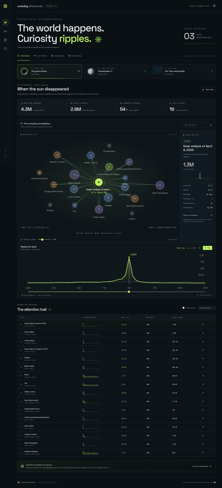
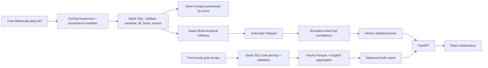

# Curiosity Aftershocks

**The world happens. Curiosity ripples.**

A complete big-data analytics project that studies how collective attention changes around major events. It combines genuine Wikipedia pageviews, Apache Spark SQL, Spark MLlib, partitioned Parquet, a FastAPI service, and an interactive React / TypeScript observatory.

No paid datasets, API keys, LLM subscriptions, or cloud accounts are required. The application runs on your own computer. This repository does not claim causality, track individuals, or fabricate observations.



## What you can do

- Automatically discover current traffic spikes in the **Live monitor**, with real hourly source timestamps and a continuously updated candidate graph.
- Explore three curated event studies: the April 2024 solar eclipse, Chandrayaan-3's August 2023 landing, and the June 2023 Titan submersible event.
- Click a topic in a constellation to inspect daily traffic, baseline, lift, burst days, peak delay, and temporal cluster.
- Scrub or replay a 50-day observation window; node sizes respond to the selected day's attention lift.
- Filter topics, adjust the correlation threshold, sort attention signals, and include everyday comparison articles.
- Export every observation and its computed metrics as CSV.
- Inspect source provenance, baseline evaluation, actual Spark execution time, and bulk-ingestion throughput.
- Download complete Wikimedia hourly dumps and process millions of records through Spark into Parquet.

The default analytical cohort is intentionally small enough to understand: **3 events × 19 topics × 50 days = 2,850 observations**. The separate bulk ingestion pipeline demonstrates large-scale processing on complete hourly dumps. The UI clearly separates these two paths; bulk records are never represented as the study cohort's sample size.

## Prerequisites

| Tool | Requirement |
|---|---|
| Python | 3.11–3.13; developed and tested with 3.12 |
| Java | JDK 17 or 21; tested with OpenJDK 21 |
| Node.js | 22.12+ recommended; tested with Node 24 |
| uv | Python dependency management; install from https://docs.astral.sh/uv/ |
| npm | Bundled with Node |
| curl | Used for public API downloads; must be on PATH |
| RAM | 8 GB recommended; Spark defaults to two local execution threads and a 1 GB JVM heap |
| Disk | Allow several GB for dependencies, cached downloads, and Parquet |

The exact Python and JavaScript dependency resolutions are recorded in `uv.lock` and `frontend/package-lock.json`.

## Quick start

Run these commands from the repository root:

```bash
make setup      # install locked Python and frontend dependencies
make reproduce  # run Spark on the included real-data snapshot; build the UI
make serve      # serve the production UI and API on one local port
```

Open **http://127.0.0.1:8000**. Interactive API documentation is available at **http://127.0.0.1:8000/docs**.

The first setup downloads Spark and frontend packages. `make reproduce` rebuilds the analytics from the included CC0 reference snapshot without contacting Wikimedia. To refresh from the original sources, run `make data`; to rebuild only the frontend, run `make build`. The first data run makes 57 small public API requests, sequentially with a seven-second interval and bounded rate-limit backoff. Subsequent runs reuse cached responses. Set `WIKIMEDIA_USER_AGENT` to your own descriptive agent with a contact URL/email when running public downloads; `Retry-After` is honored. Data retrieval requires internet; the built app works offline once its analytics artifact and frontend assets exist. Google Fonts is optional; system fonts are used when unavailable.

For frontend development after building data:

```bash
make dev
```

Open **http://127.0.0.1:5173**. Vite proxies `/api` to FastAPI on port 8000. `Ctrl+C` stops both processes. Avoid running `make serve` and `make dev` simultaneously because they share the API port.

### Build without Make

```bash
uv sync --locked
npm --prefix frontend ci
uv run python -m aftershocks.pipeline --raw data/reference
npm --prefix frontend run build
uv run uvicorn aftershocks.api:app --host 127.0.0.1 --port 8000
```

## Real large-scale ingestion

```bash
make bulk
```

This downloads the complete **2024-04-08 18:00 UTC** Wikimedia pageviews gzip file, parses every record with Spark, validates fields, writes all valid projects to partitioned Parquet, aggregates English desktop/mobile views, and publishes a measured run report. Reload the Data pipeline view to see its result.

Download other hours explicitly:

```bash
uv run python -m aftershocks.bulk --date 2024-04-08 --hours 17 18 19
```

Or process already-downloaded files:

```bash
uv run python -m aftershocks.bulk \
  --input data/raw/hourly/pageviews-20240408-180000.gz
```

Hourly files are typically tens to hundreds of MB compressed. Each additional hour increases bandwidth, storage, and processing cost on your own machine. Nothing is billed by this project. Downloads use temporary files; interrupted partial files are not mistaken for complete inputs.

**Verified on this device:** 7,750,691 source records, 63.0 MiB compressed input, 164.53 seconds end-to-end processing (download excluded), 47,107 records/second, and zero rejected records. An independent streaming parser confirmed the record count. These are single-machine measurements, not universal performance promises.

**A methodological distinction:** hourly dumps include automated traffic and encode project/access information differently from the daily API's `agent=user` observations. We retain that distinction rather than merge incompatible counts. The default event studies use the daily API. The bulk path provides the raw foundation for future hourly studies, not an unimplemented claim of hourly event analysis.

## Architecture



### Where the big-data tools actually do work

| Component | Actual responsibility |
|---|---|
| Apache Spark SQL | Reads observations/dumps; validates counts; joins event dates; groups and aggregates baselines; computes burst and lift features; uses windows for peak dates; reshuffles and writes Parquet |
| Spark MLlib | Fits four-cluster KMeans to normalized temporal response vectors across the curated cohort |
| Apache Parquet | Stores typed columnar silver/gold tables, partitioned by event or input hour |
| FastAPI | Serves an atomically published compact analytical artifact; does not launch Spark inside web requests |
| React + TypeScript | Interactive visualization and research interface; all study numbers originate in the API |

Spark defaults to `local[2]` to coexist with the UI and browser on a student laptop. This is real Spark execution on one machine, **not a distributed cluster benchmark**. Gzip files are not splittable, so multiple hour files provide more input-stage parallelism; conversion to Parquet improves subsequent parallel reads.

You can supply `--master` or `SPARK_MASTER` for an existing Spark cluster. Cluster operation requires matching Python/Spark installations and filesystem paths visible to executors. The local setup is the tested default; a multi-node deployment is not bundled or claimed as verified.

## Research design

### Events and cohort

| Study | Event date, UTC | Observation window |
|---|---|---|
| Solar eclipse | 2024-04-08 | 2024-03-11 → 2024-04-29 |
| Chandrayaan-3 | 2023-08-23 | 2023-07-26 → 2023-09-13 |
| Titan submersible | 2023-06-18 | 2023-05-21 → 2023-07-09 |

Each event has 16 related articles and three comparison articles: Coffee, Bicycle, and Photography. Topic selection and categories are manually curated in `aftershocks/catalog.py`; the project does not claim automated semantic discovery. Controls are comparisons, not proof of an unaffected counterfactual. The Titan study's day zero is the disappearance date, not the later announcement.

All studies use English Wikipedia, `all-access`, `agent=user`, daily UTC counts. Article title changes, redirects, and Wikimedia counting revisions can affect series; current API responses are cached with checksums. Titles without a complete pre-event history (including the queried Titan incident and OceanGate titles) are excluded; the Titan study uses Wreck of the Titanic as its constellation anchor. Missing days are rejected instead of silently imputed as zeros.

### Baseline and anomalies

For article `a`, the pre-event set consists of days −28 through −1:

```text
μ = mean(pre-event daily views)
σ = population standard deviation(pre-event daily views)
lift(t) = views(t) / max(μ, 1)
z(t) = (views(t) − μ) / max(σ, sqrt(μ), 1)
excess(t) = max(views(t) − μ, 0)
burst day = z(t) ≥ 3
```

The variance floor avoids infinities for zero or constant baselines. It is a practical heuristic, not a calibrated significance test. Post-event totals sum days 0 through +21; excess views are summed positive departures, not signed net changes. Peak delay is the first post-event day with the highest count. “Strongest aftershock” is the largest article-level post-event lift in the cohort.

### Temporal clustering

For each article/event pair, construct 22 features: `log(1 + lift)` for days 0 through +21. L2 normalize the vector and run Spark MLlib KMeans (`k=4`, `seed=42`, `maxIter=30`) across the study cohort. This groups response shapes; IDs C1–C4 are arbitrary and may permute on rebuilds. The constellation's colors represent curated subject categories, not model clusters; clusters appear in the inspector/table.

### Graph relationships

For each pair of non-control articles, compute Pearson correlation between `log(1 + views)` series at integer lags −5 through +5 days. Retain the strongest positive match when correlation ≥ 0.72. The UI can raise that threshold. Positive-lag direction in the exported artifact describes which series leads the fitted alignment; the graph intentionally shows undirected curves to avoid implying causal transmission. Graph positions are deterministic display coordinates, not geographic positions or embedding distances.

The pairwise step is intentionally bounded to at most 40 topics and executes in NumPy after Spark reduces the data. It is not a distributed all-Wikipedia graph algorithm. Looking across multiple lags inflates apparent correlations; there is no multiple-comparison correction or significance claim.

### Evaluation

Train a constant-mean forecast on days −28 through −8, then evaluate against the seven held-out pre-event days −7 through −1:

- **MAE:** average absolute error in views per article/day.
- **WAPE:** sum of absolute errors divided by total held-out views.

These measurements test how stable the baseline is. They do not measure precision/recall of an anomaly classifier, because the data has no ground-truth burst labels. Anticipation of scheduled events can make baseline error high. The UI exposes the actual values for each study.

## Data sources and cost

- [Wikimedia pageview dumps](https://dumps.wikimedia.org/other/pageviews/): public downloads, no account.
- [Dataset definition and CC0 dedication](https://dumps.wikimedia.org/other/pageviews/readme.html).
- [Wikimedia Analytics API](https://doc.wikimedia.org/generated-data-platform/aqs/analytics-api/): public article traffic endpoint.
- [Apache Spark documentation](https://spark.apache.org/docs/4.0.1/): processing framework.

The ingestion manifest records exact request URLs, observation counts, response hashes, the combined input hash, and assembly time. Bulk downloads have a separate SHA-256 manifest. Retrying ingestion reuses existing cached responses; delete the relevant response file deliberately if you want to retrieve a fresh copy. Assembly time describes when a manifest was rebuilt and is not proof every cached response was fetched at that moment.

No GDELT, paid news text, private user histories, or synthetic data is required. Wikimedia CC0 covers the statistics. Linked Wikipedia article content is not copied into this project.

## Repository map

```text
aftershocks/
  catalog.py        Curated studies, seeds, and categories
  ingest.py         Cached daily API retrieval and provenance
  pipeline.py       Spark SQL, MLlib, bounded lag graph, publication
  bulk.py           Complete hourly dump ingestion and measured report
  api.py            FastAPI read and CSV export endpoints
frontend/
  src/App.tsx       Observatory, timeline, inspector, research views
  src/styles.css    Responsive visual system and reduced-motion support
  tests/            Browser interaction and failure-state tests
scripts/dev.py      Local API + frontend process lifecycle
tests/              Spark calculations, malformed data, API, artifact checks
data/reference/     Included real CC0 observations + provenance; offline reproduction
data/raw/           Ignored source cache and manifests
data/processed/     Ignored Parquet, dashboard artifact, bulk report
docs/               Screenshots and verification evidence
```

## API

| Endpoint | Purpose |
|---|---|
| `GET /api/health` | Reports readiness / awaiting-data state |
| `GET /api/events` | Event summaries |
| `GET /api/events/{id}` | Topics, series, edges, timeline, evaluation |
| `GET /api/events/{id}/export` | CSV of daily observations and metrics |
| `GET /api/pipeline` | Provenance and measured run metadata |

IDs are `eclipse`, `moon`, and `titan`. Unknown IDs return 404. Missing analytics returns a readable 503 with a rebuild instruction. Exports neutralize spreadsheet formula prefixes in article titles. Historical analytics routes are read-only; explicit monitor controls launch/stop a local background job. The service binds to localhost by default.

Set `AFTERSHOCKS_DATA=/absolute/path/dashboard.json` to serve another generated artifact. Its companion bulk report is read from the same directory. The production UI is served only when `frontend/dist` exists at server startup; rebuild and restart after changing frontend code.

## Verification

```bash
make check                  # Python lint + strict TypeScript + production build
uv run pytest -q            # Spark, API, and real artifact integrity
cd frontend
npm run test:e2e            # Chrome: interaction, mobile, failure and retry
```

Browser tests start FastAPI automatically if needed. Build the UI and data first. They default to `/usr/bin/google-chrome`; override with `CHROME_PATH=/path/to/chrome`. Alternatively install a compatible browser separately. Tests do not need a paid browser service.

Covered behavior includes leakage-free baselines, zero variance, known lag direction, malformed hourly rows, API 404/503, CSV safety, real series completeness, event switching, topic selection, replay, search, controls, sorting, CSV download, methodology/pipeline tabs, mobile overflow, keyboard skip navigation, and recoverable API failures.

See `docs/VERIFICATION.md` for measurements and commands from this device. Passing these checks is evidence for those paths, not a guarantee that every environment or future upstream response will be error-free.

## Troubleshooting

**`JAVA_GATEWAY_EXITED` / Java not found:** install JDK 17 or 21, verify `java -version`, and set `JAVA_HOME` to the JDK installation when required. Spark binds locally using `SPARK_LOCAL_IP=127.0.0.1` by default.

**503 / no analytics:** run `make data`. There is no fabricated fallback dataset.

**Source download fails:** verify internet connectivity and retry. Completed responses are cached. The API downloader uses curl because Wikimedia's edge rejected the Python HTTP transport during development. Respect upstream rate limits; do not increase concurrency aggressively.

**Frontend 404 at `/`:** run `make build`, then restart the API so it mounts the built assets.

**Port already in use:** stop the other project-owned server, or supply a different uvicorn port and update the Vite proxy when using development mode.

**Memory pressure:** close other heavy applications, keep the default `local[2]`, and process fewer hourly files per run. The bulk path writes larger Parquet outputs, while the curated dashboard artifact remains bounded.

**Unexpectedly large lifts:** an article can have a small pre-event denominator, especially around newly prominent topics. Inspect its absolute views and baseline; lift alone is not importance.

## Course presentation outline

1. Show a real event and ask which unexpected topics gained attention.
2. Replay the constellation, inspect a high-lift article, and compare absolute traffic with its baseline.
3. Explain the data source, event windows, controls, and leakage-free baseline.
4. Show the real Spark SQL and MLlib transformations and partitioned Parquet outputs.
5. Open the pipeline view and report actual bulk records, throughput, and hardware context.
6. Present held-out baseline error and limitations: selection bias, anticipation, temporal aggregation, and correlation versus causation.

## License

Application code: MIT. Wikimedia analytics observations: CC0. See `LICENSE` and the linked source documentation.

## Recent-event monitor (new)

Open **Live monitor** to investigate a real event from the past 24 hours. Enter its name and actual occurrence time (your browser's local timezone), optionally exclude literal headline terms, and click **Start monitoring**. The API launches one owned background worker; it does not require an LLM, API key, or paid streaming service.

The event name/context define the relevance query, and its time defines the observation window. Required concepts and Spark MLlib TF-IDF filter traffic spikes before graph selection. This indicates topical relevance, **not** evidence that the event caused those changes. Headline exclusions remain optional literal title filters.

### What happens automatically

1. Check Wikimedia's public monthly file indexes for completed hourly dumps.
2. Download available baseline files from the three UTC hours preceding the event's hour. A partially available baseline is processed as it arrives; missing files are not fabricated.
3. Ingest each complete gzip file through a real **Spark Structured Streaming file source**, `foreachBatch`, and an `availableNow` trigger. A per-file checkpoint and committed report make completed files reusable without double-counting.
4. Aggregate English desktop/mobile traffic into cached Parquet; exclude namespace/system titles. This scans the broad source universe rather than 19 chosen articles.
5. Scan each newly observed post-event hour against the fixed pre-event baseline. Discover titles with all three baseline observations, baseline mean ≥ 10 views/hour, current views ≥ 200, lift ≥ 3, excess ≥ 100, and burst score ≥ 4. The burst score uses the same variance-floor formula as the historical studies.
6. Check Wikipedia descriptions for the strongest 300 spikes using the event-relevance filter described below; display up to 24 accepted candidates ranked by excess views. Compute graph links from Pearson correlation of observed `log(1 + views)` values, requiring at least five shared hourly points and correlation ≥ 0.85. Missing article/hour observations remain missing; they are not silently zero-filled. There are no causal arrows from the event to candidates.
7. Check for newly published files every five minutes. The browser polls the job's small status artifact every five seconds. Respect source `Retry-After` on temporary errors. Stop automatically after the 24-hour event window and a three-hour publication grace period.

**This is near-real-time batch publication, not a second-by-second data feed.** Publication delay can be hours; full-file downloads and local Spark processing add further latency. The UI displays the latest observed hour, data age, baseline readiness, processing stage, and journal. It never labels accelerated historical data as live.

For a presentation, select an actual event several hours old and start the monitor **before** the presentation so the baseline can finish. Newly arrived hourly files then update the graph without manual topic selection. If no titles meet the thresholds or there are too few shared points for links, an empty result is valid. A recent event with no published observations cannot produce an honest instant graph.

### Runtime and resources

- Keep the API server running. **Stop monitoring** stops its owned process group and retains the last observations. A graceful server shutdown also stops the worker. A server restart shows prior unfinished work as interrupted; starting again reuses completed hourly cache entries.
- One worker per API instance; a cache-level process lock prevents concurrent writers from other instances.
- A first run downloads multiple complete hourly files (typically hundreds of MB total) and may take several minutes. A full 24-hour watch can use several GB. All storage is local and no service bills are created.
- Files live under ignored `data/monitor/`: `runs/<id>/config.json`, atomic `state.json`, checkpoints and worker logs; shared `cache/<hour>/parquet`, `report.json`, source manifests, and raw downloads.
- `AFTERSHOCKS_MONITOR_DIR` can relocate monitor state/cache. The current process lifecycle uses POSIX process groups and file locks; Linux is the verified environment.
- Restart a server that was already running before this update to load the new API routes.

### Monitor API

| Endpoint | Behavior |
|---|---|
| `GET /api/monitor` | Actual process state, observed candidates, graph, provenance timestamps and progress |
| `POST /api/monitor/start` | JSON `{ "name": "Event name", "occurred_at": "<ISO timestamp with timezone>", "exclude_terms": [] }`; validates the past-24-hour window; 409 if this API already owns an active monitor |
| `POST /api/monitor/stop` | Stops only this API's owned job; preserves last results |

The normal historical analytics endpoints remain read-only. Keep the application bound to localhost; the monitor start endpoint performs local downloads and computation.

### Scientific limits

A three-hour baseline is a fast exploratory baseline, not a seasonally adjusted model. Daily cycles, simultaneous news, automated traffic, and sparse/new titles affect interpretation. Complete-case eligibility excludes titles missing any baseline sample. High co-movement among selected spikes can be a selection artifact, and correlations are not corrected for multiple testing. The monitor discovers **candidate anomalies**, not verified event effects or objectively unrelated subjects.

Implementation: `aftershocks/monitor.py` (validation, lifecycle, scoring), `aftershocks/live_worker.py` (source discovery, Structured Streaming, graph publication), and `frontend/src/LiveMonitor.tsx` (monitor controls and live discovery UI).

Monitor source-row totals describe the records represented by completed hourly cache entries. Restarting a watch reuses those entries; it does not imply that all raw rows were newly re-ingested in that run.

For a step-by-step presentation script, see [the live demo guide](docs/LIVE_DEMO.md). Fresh-data validation results are recorded in [the verification report](docs/VERIFICATION.md).

### Event-relevance filtering (live monitor)

The live graph now requires **both a traffic spike and a topical relevance match**.
Supply an event name and optional context (location, issue, people/organizations).
Required relevance terms are comma-separated concepts; all must occur in the
article's lead text/title/categories. Leaving them blank derives concepts from the
event name. At least two concepts are needed. For the France-protest watch, use
`France, protest`; French and protest/demonstration/unrest/strike variants are normalized.
Other event vocabularies currently use literal words, so explicit terms help.

The strongest **300** traffic spikes by excess views are checked, before choosing
24 graph nodes. Public Wikipedia introductory extracts and up to 20 categories per
article are fetched in batches and cached for 24 hours. Spark MLlib `HashingTF`
(binary, 262,144 features), `IDF`, and L2 `Normalizer` produce cosine similarity to
the event context. IDF weights use `1 + IDF` so tiny candidate pools do not lose
shared concepts. The fixed exploratory cosine cutoff is **0.06**; it is not a
probability or calibrated classification accuracy. Every required concept must
also match. Inspector explanations include matched concepts, similarity, source,
and the fetched text. Article extracts are Wikipedia CC BY-SA content (unlike the
CC0 traffic counts).

Missing descriptions are excluded. Source failures put the watch into retrying
rather than publishing unfiltered candidates. Zero accepted topics is a legitimate
result. The interface distinguishes all traffic spikes, the checked pool, and
accepted relevant spikes. Topics ranked below 300 can be missed. Text similarity
can still match older protests or superficial vocabulary; it demonstrates topical
relevance, **not a verified connection to the specific event or causal impact**.
